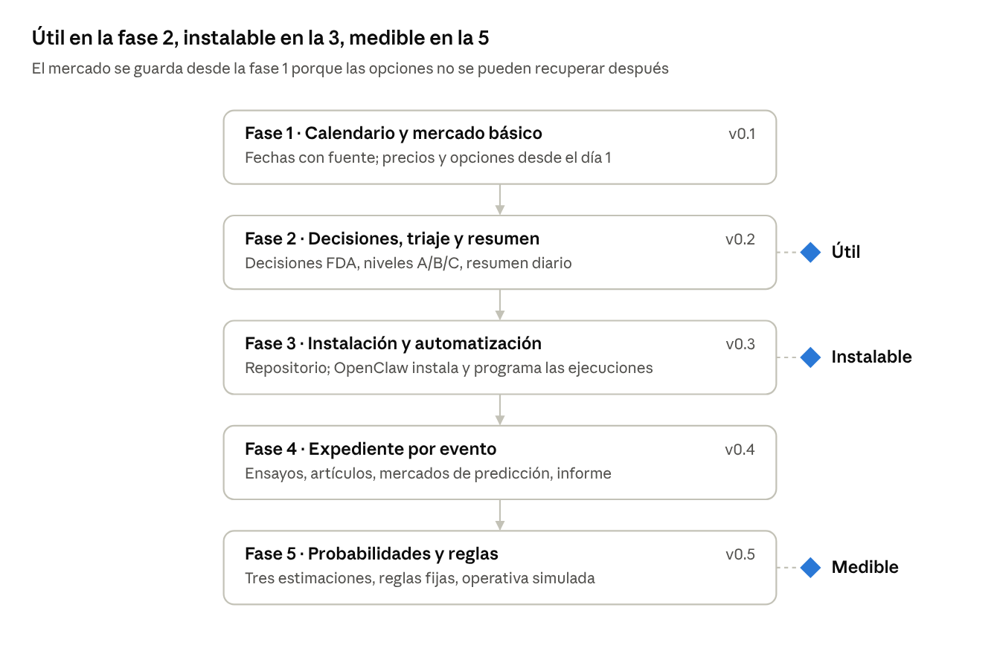

# FDA Catalyst Intelligence — Plan de implementación

Nov 5, 2026 · @Dani

Cinco fases. Cada una deja el sistema funcionando y añade una capa encima: tras la segunda ya es útil a diario y tras la tercera se instala desde tu repositorio. Criterio general: lo más simple que funcione. La información técnica está en el documento hermano, la [referencia técnica](reference.md).

## Cómo se construye

Se hace lo más simple que funcione y no se añade nada hasta que un problema real lo pida. Cada fase termina con algo que se usa de verdad.

### Principios

1.  **Simplicidad.** SQLite, un CLI y ficheros. Nada de Docker, servidores web, colas ni comprobaciones que nadie vaya a mirar.

2.  **Interfaces estables.** Los comandos, el contrato `sync()` y las tablas solo crecen; renombrar algo exige migración y una línea en el CHANGELOG.

3.  **Lo incompleto se apaga.** Un conector a medias queda desactivado en `config/sources.yaml` y no rompe nada.

4.  **Pruebas sin red.** Las pruebas usan respuestas grabadas y no dependen de la fecha. Antes de cada versión se lanza a mano una prueba contra las APIs reales.

5.  **Sin trading.** Ninguna fase conecta con un bróker ni envía órdenes.

### Ciclo de cada fase

Igual a mano, con Claude Code o con otro agente:

1.  Leer la fase y las fichas de las fuentes que toca en la referencia técnica.

2.  Probar cada fuente nueva contra la API real y grabar la respuesta como fixture.

3.  Implementar, con migración SQL si hace falta.

4.  Pruebas en verde.

5.  Probar con datos reales sobre los eventos de referencia.

6.  Actualizar README y AGENTS.md, fusionar a `main` y etiquetar la versión.

### Versiones

`v0.1` a `v0.5` al cerrar cada fase; `v1.0` cuando la fase 5 lleve tres meses de operativa simulada. El VPS instala siempre una etiqueta, nunca `main`.

## Hoja de ruta

Cinco fases en orden, cada una apoyada en la anterior.

hoja de ruta · 5 fases, 3 hitos

Tras la fase 2 ya tienes calendario, decisiones, triaje y un resumen diario en el Mac. La fase 3 lo lleva al VPS. Las fases 4 y 5 añaden el análisis profundo y la medición de si todo esto gana dinero.

## Fase 1 — Calendario y mercado básico (v0.1)

Un calendario de catalizadores en el que cada fecha tiene fuente e historial, y desde el primer día se guardan precios y opciones de esas empresas. Los datos de opciones no se pueden recuperar después, así que se acumulan aunque todavía no se analicen.

**Entregables**

- Repositorio con `uv`, CLI (`init`, `db upgrade`, `status`, `run`, `calendar`, `event`) y SQLite con la primera migración.

- Cliente HTTP con límite por fuente, reintentos y `User-Agent` configurable.

- Conectores `pdufa_bio`, `edgar` (submissions de la lista de seguimiento y búsqueda de texto completo) y `wires` (RSS de agencias de comunicados).

- Extractor de anuncios con LLM: fármaco, indicación, tipo de solicitud, fecha, precisión y cita. Si la cita no aparece en el documento, el dato se descarta.

- Historial de fechas: un cambio añade una fila; las discrepancias se muestran como conflicto.

- **Mercado básico** (`run market`): cada día tras el cierre, precio, volumen y capitalización de las empresas del calendario, y su cadena de opciones completa guardada como JSON, con yfinance. Sin cálculos todavía.

**Pruebas clave**

- Una fecha trimestral no genera un día inventado.

- La extensión del 22 de agosto al 22 de noviembre conserva ambas fechas.

- El mismo evento visto en tres fuentes queda como un solo evento.

- Si pdufa.bio falla, EDGAR sigue funcionando.

**Criterio de salida** (sobre la lista de eventos de referencia, al final del plan)

- [ ] Todos los eventos de referencia aparecen con su fecha y fuente correctas.

- [ ] Cero duplicados y ninguna fecha sin cita.

- [ ] Los cambios de fecha de la lista se ven con su historial.

- [ ] Una semana de instantáneas diarias de mercado sin huecos.

## Fase 2 — Decisiones, triaje y resumen diario (v0.2)

El sistema sabe cuándo ha decidido la FDA, clasifica los eventos por oportunidad y te manda un resumen cada mañana. Primer hito útil.

**Entregables**

- Conectores `openfda` (`drugsfda`: aprobaciones y precedentes) y `fda_pages` (aprobaciones del día, calendario de comités, RSS).

- Cierre de eventos con fuente: carta o página de la FDA, o 8-K y comunicado de la empresa. Las CRL se detectan por la empresa; la base de CRL de openFDA no sirve para esto porque se actualiza de forma irregular.

- Comités asesores enlazados a su evento (pdufa.bio `/adcomm` y calendario de la FDA).

- Caja y meses de caja por empresa desde el XBRL de la SEC.

- **Triaje** A, B o C con `config/triage.yaml`: peso del fármaco en la empresa (marcado en `watchlist.yaml`), capitalización, liquidez, consenso del mercado e incertidumbre abierta. Solo los A pasarán al expediente completo.

- `fdaci event` con ficha breve y `fdaci digest` con decisiones, cambios de fecha y eventos A de los próximos 14 días.

**Pruebas clave**

- Una decisión anterior a la fecha PDUFA cierra el evento.

- Una CRL que solo aparece en un 8-K queda registrada con esa fuente.

- Nunca se marca «aprobado» por falta de noticias.

- `--quiet` sin novedades imprime `NO_REPLY`.

**Criterio de salida**

- [ ] Los eventos de referencia ya decididos quedan cerrados con la fuente correcta.

- [ ] Cada evento del calendario tiene nivel A, B o C y su motivo.

- [ ] Dos semanas usando el resumen diario en el Mac sin corregir datos a mano.

## Fase 3 — Instalación y automatización (v0.3)

Subes una etiqueta a tu repositorio y OpenClaw la descarga, la instala y programa las ejecuciones. En el Mac sigues lanzándolo a mano o desde Claude Code.

**Entregables**

- `scripts/install.sh <versión>`: `uv tool install git+https://github.com/<usuario>/fda-catalyst-intel@<versión>`, `fdaci init` la primera vez, `fdaci db upgrade` y `fdaci status`. El mismo script sirve para actualizar.

- `fdaci schedule --format openclaw|launchd|crontab`: genera las ejecuciones programadas para OpenClaw en el VPS o para launchd en el Mac.

- `openclaw/skills/fdaci/SKILL.md`: comandos disponibles, dónde están los informes y cómo instalar o actualizar.

- `AGENTS.md` y `CLAUDE.md`: lo mismo para Claude Code en el Mac.

- Copia de seguridad nocturna de la carpeta de datos, como una ejecución programada más.

- README con instalación en 10 minutos.

**Pruebas clave**

- Instalación desde cero en un Ubuntu limpio y en macOS.

- Dos ejecuciones simultáneas de la misma tarea: la segunda no hace nada.

- Restaurar una copia de seguridad.

**Criterio de salida**

- [ ] OpenClaw instala una etiqueta en un VPS limpio siguiendo la skill.

- [ ] Siete días de ejecuciones programadas sin intervención, con el resumen llegando al canal.

- [ ] Actualizar a una etiqueta nueva funciona igual: instalar y `fdaci db upgrade`.

- [ ] Claude Code lanza cualquier módulo en el Mac siguiendo `AGENTS.md`.

## Fase 4 — Expediente por evento (v0.4)

Los eventos de nivel A reciben un informe completo: ensayos, publicaciones, mercados de predicción y opciones, con cada cifra citada y los contraargumentos a la vista.

**Entregables**

- `ctgov`: ficha de los ensayos pivotales y aviso si cambian el endpoint primario, el tamaño o las fechas (se compara la copia de hoy con la de ayer).

- `europepmc`: artículos, preprints y abstracts de congresos en una sola fuente.

- **Informes 10-Q y 10-K** de la empresa (trimestral y anual, en EDGAR): de los más recientes se extrae, con cita, lo que la empresa cuenta de la revisión (peticiones de información de la FDA, *major amendment*, reunión de ciclo tardío, comité asesor previsto), fabricación e inspecciones, acuerdos con socios y regalías, caja explicada y riesgos propios del fármaco. Muchas empresas pequeñas solo dan su fecha PDUFA o el resultado en estos informes, sin 8-K. Llegan 40–90 días después del cierre del periodo: sirven para investigar y completar el histórico, no para enterarse antes. Pesan 1–3 MB cada uno, así que se guardan solo las frases útiles.

- Extracción de cifras clínicas con cita y comprobaciones sencillas (p entre 0 y 1, el intervalo contiene la estimación, el n cuadra). Si dos documentos discrepan, conflicto; si el texto no lo deja claro, ambiguo y vacío.

- Revisión a mano de las 3–5 cifras que sostienen la tesis de cada evento A antes de usarlas en el informe.

- `kalshi` y `polymarket`: un contrato se enlaza solo si coinciden fármaco, indicación y plazo; se guarda el punto medio y el diferencial.

- Movimiento implícito calculado con las instantáneas de opciones acumuladas desde la fase 1.

- `fdaci report <id>`: ficha, datos clínicos, historial regulatorio, caja, mercado, mercados de predicción, contraargumentos (un segundo paso del LLM que busca lo que contradice la tesis), vacíos y fuentes. Se guarda con la fecha y nunca se sobrescribe.

**Pruebas clave**

- Un contrato con otro plazo no se enlaza al evento.

- Oferta 0,35 y demanda 0,75 se muestran como rango, no como 55 %.

- Una p fuera de 0–1 o un intervalo que no contiene la estimación se rechazan.

- Dos cifras distintas para el mismo dato quedan en conflicto.

**Criterio de salida**

- [ ] Informes de tres eventos A reales, revisados por ti y guardados antes de su decisión.

- [ ] Ninguna cifra del informe sin cita.

## Fase 5 — Probabilidades, reglas de operación y backtest (v0.5)

Tres preguntas separadas y con respuestas sencillas: ¿se aprobará?, ¿cuánto se movería la acción en cada caso?, ¿una regla fija de entrada y salida habría ganado dinero? Nada de modelos complejos hasta tener datos que los justifiquen.

**Entregables**

- Tasa base de aprobación por categoría (tipo de solicitud, revisión, área, comité y voto, resubmisión), con estadísticas publicadas y los eventos que el sistema va cerrando.

- Probabilidad de aprobación como rango, ajustada con un máximo de seis factores justificados. El LLM propone; tú apruebas.

- Movimiento por escenario (aprobación, CRL, y si aplica restricción o retraso) a partir del movimiento implícito y de casos comparables; riesgo de ampliación de capital según la caja.

- Reglas de operación en `config/rules.yaml`, fijadas antes de mirar resultados: R1 entra al cierre del día hábil anterior a la fecha PDUFA y sale en la primera apertura tras el anuncio; R2 igual pero sale al cierre del quinto día hábil. Incluyen costes, anuncios fuera de sesión, suspensiones y ampliaciones de capital.

- Backtest de R1 y R2 con precios diarios históricos (yfinance los tiene; las opciones históricas no) y fechas pasadas de pdufa.bio y EDGAR.

- Operativa simulada: cada evento A registra entrada y salida según R1 y R2 en la tabla `paper_trade`.

- `fdaci backtest`: puntuación de Brier de la probabilidad frente a la tasa base y al mercado de predicción, y resultado de cada regla con el número de eventos.

**Pruebas clave**

- Un backtest a fecha T no usa nada publicado después de T.

- Cambiar una regla crea una regla nueva que solo se evalúa con eventos futuros.

**Criterio de salida**

- [ ] Backtest de los eventos de los últimos 12 meses con las reglas fijadas.

- [ ] Tres meses de operativa simulada antes de `v1.0`.

**Después**: con esos resultados se decide con calma. Cualquier conexión a un bróker sería otro proyecto, con aprobación humana en cada operación.

## Pruebas clave y eventos de referencia

La calidad se mide contra una lista fija de eventos conocidos, no contra cuántos eventos haya en el calendario. Diez pruebas protegen lo esencial; no hacen falta más al principio.

### Las diez pruebas

1.  Una fecha con precisión de mes o trimestre nunca genera un día concreto.

2.  Un cambio de fecha conserva la anterior en el historial.

3.  El mismo evento en varias fuentes, o anunciado por dos empresas socias, es un solo evento.

4.  Ningún dato sin cita que aparezca en su documento.

5.  Nunca «aprobado» por falta de noticias.

6.  Si una fuente falla, las demás siguen y `fdaci status` lo muestra.

7.  Una cifra clínica imposible o contradictoria no se acepta en silencio.

8.  Un contrato de predicción con otro plazo no se enlaza.

9.  Un backtest a fecha T no ve nada posterior a T.

10. Los mismos comandos y fixtures dan el mismo resultado en el Mac y en Linux.

### Eventos de referencia

En `tests/reference_events.yaml`, con el resultado esperado de cada uno. Empezar con estos cuatro y completar hasta unos 15 con decisiones ya conocidas: aprobaciones, CRL, extensiones y fechas adelantadas. Revalidar las fechas al usarlos; no son señales de inversión.

| Caso                        | Qué comprueba                                                                            |
|-----------------------------|------------------------------------------------------------------------------------------|
| Summit (SMMT), ivonescimab  | Fecha PDUFA del 14 de noviembre de 2026, contrato en Kalshi, fármaco licenciado de Akeso |
| Savara (SVRA), molgramostim | Extensión del 22 de agosto al 22 de noviembre de 2026; agregadores con la fecha antigua  |
| Nuvalent (NUVL), neladalkib | Revisión prioritaria con fecha el 27 de noviembre de 2026                                |
| Capricor (CAPR), deramiocel | Comité asesor del 29 de julio de 2026 sobre su BLA 125842                                |

### Un conector está terminado cuando

- [ ] Funciona con `fdaci run`, respeta los límites de su fuente y deja su estado en `fdaci status`.

- [ ] Guarda el documento original y la cita de cada dato.

- [ ] Tiene una prueba con respuesta grabada.

- [ ] Tiene una ficha breve en `docs/sources/` con la fecha en que se verificó la API.

## Decisiones abiertas y riesgos

Cuatro decisiones son tuyas; ninguna bloquea la fase 1 salvo la primera.

| Decisión                                     | Opciones                                                               | Cuándo            |
|----------------------------------------------|------------------------------------------------------------------------|-------------------|
| Proveedor de LLM para extracción y redacción | Cualquiera con salida JSON fiable                                      | Fase 1            |
| Cómo programar en el VPS                     | Tareas de comando de OpenClaw (tu caso) o cron                         | Fase 3            |
| Canal de OpenClaw                            | Telegram, WhatsApp, Slack, Discord                                     | Fase 3            |
| Datos de opciones de pago                    | Solo si yfinance falla o se queda corto: Massive o Interactive Brokers | Cuando haga falta |

| Riesgo                                      | Qué se hace                                                                    |
|---------------------------------------------|--------------------------------------------------------------------------------|
| Fechas erróneas o desfasadas en agregadores | Fuente primaria manda; discrepancias como conflicto                            |
| La FDA decide antes o después de la fecha   | El evento sigue abierto hasta ver la decisión                                  |
| Cambia una API o una página                 | `fdaci status` lo muestra; se arregla ese conector                             |
| yfinance deja de funcionar                  | Cambiar `MARKET_PROVIDER`; el resto no cambia                                  |
| El LLM inventa o malinterpreta              | Cita obligatoria, comprobaciones simples y revisión a mano de las cifras clave |
| Pocos eventos para sacar conclusiones       | Comparar siempre con la tasa base y no ajustar modelos hasta tener datos       |
| Kalshi y Polymarket bloqueados en España    | Módulo opcional; si no responde, se marca y el resto sigue                     |
