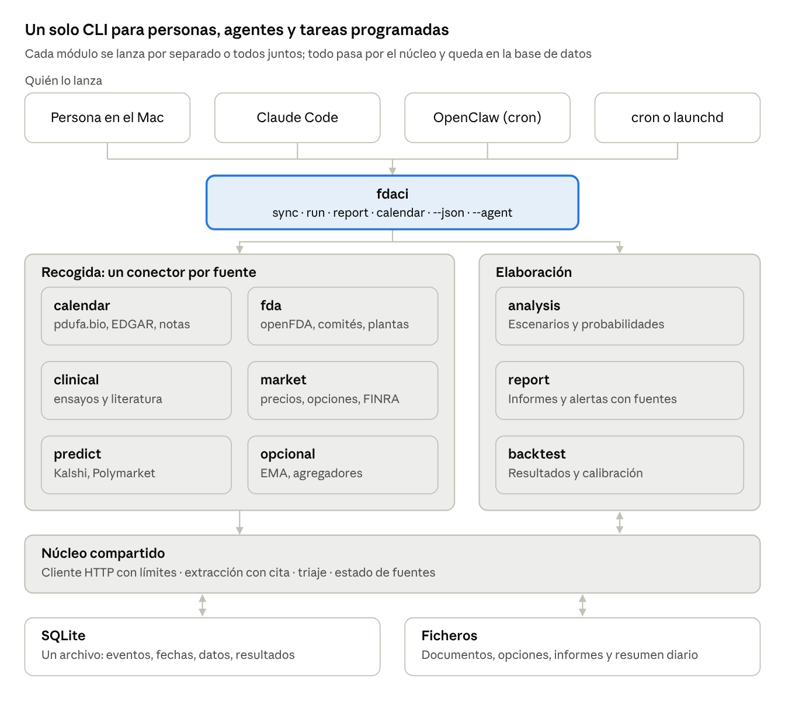

# FDA Catalyst Intelligence — Referencia técnica

Nov 5, 2026 · @Dani

Todo lo que necesita quien construya o use el sistema: fuentes, accesos, reglas de datos, modelo, análisis e interfaz. El orden de construcción está en el documento hermano, el [plan de implementación](plan.md).

## Propósito, alcance y principios

El sistema localiza decisiones de la FDA y lecturas de ensayos de empresas cotizadas, reúne la evidencia pública con su fuente, la compara con lo que descuenta el mercado y genera un informe por evento. La decisión de operar es siempre de una persona.

### Qué hace

- Calendario de catalizadores (PDUFA, comités asesores, lecturas de ensayos) con precisión de fecha, historial de cambios y fuente.

- Guarda cada día precios y opciones de las empresas del calendario desde el primer día, aunque todavía no se analicen.

- Triaje: decide qué eventos merecen análisis profundo según su posible impacto económico.

- Expediente de los eventos importantes: datos clínicos, historial regulatorio, caja, opciones y mercados de predicción.

- Tres estimaciones separadas: probabilidad de aprobación, movimiento de la acción en cada escenario y resultado de una regla de operación fijada de antemano.

- Resumen diario y registro del resultado real de cada evento.

### Qué no hace

- No ejecuta órdenes ni se conecta a cuentas de bróker o de mercados de predicción.

- No usa información no pública ni salta inicios de sesión o muros de pago.

- No da recomendaciones de inversión ni clínicas.

### Principios

1.  **Lo simple primero.** Un CLI, un archivo SQLite y carpetas de ficheros. Sin Docker, sin servidor web, sin colas. Solo se añade complejidad cuando un problema real lo pide.

2.  **Los datos salen de documentos.** Cada fecha y cada cifra clave lleva URL y cita breve. El LLM lee y resume, pero no inventa; lo ambiguo queda sin resolver.

3.  **El historial no se borra.** Un cambio de fecha añade una fila y marca la anterior como sustituida.

4.  **Dos fechas por dato**: cuándo se publicó y cuándo lo vio el sistema. Con eso basta para un backtest honesto.

5.  **Cada módulo funciona solo.** Si una fuente falla, se anota y el resto sigue.

6.  **Investigar donde hay oportunidad.** El análisis profundo se reserva para los eventos que pasan el triaje.

### Estado de cada dato

| Estado        | Significado                                                            |
|---------------|------------------------------------------------------------------------|
| confirmado    | Está en un documento primario (SEC, FDA, empresa, registro de ensayos) |
| sin confirmar | Solo aparece en un agregador o aún no tiene fuente primaria            |
| conflicto     | Dos fuentes dicen cosas distintas: se muestran ambas                   |
| ambiguo       | El documento no permite saberlo con seguridad: se deja vacío           |

### Límites legales y prácticos

- **España**: la DGOJ bloqueó en mayo de 2026 las webs de Kalshi y Polymarket como medida cautelar ([DGOJ](https://www.ordenacionjuego.es/en/node/3309)). El sistema solo lee sus precios; si no responden, lo anota y sigue.

- **Términos de uso**: respetar los límites de cada fuente y la atribución que pide pdufa.bio en su plan gratuito. yfinance y los datos de mercado, solo para uso personal.

- **Contenido de terceros**: guardar enlaces y citas breves; texto completo solo con licencia abierta.

## Arquitectura y distribución

Un paquete Python con un único comando, `fdaci`. Los datos viven en un archivo SQLite y en carpetas de ficheros dentro de `FDACI_HOME`: copiar esa carpeta es la copia de seguridad.



arquitectura · 4 lanzadores, 1 CLI, 9 módulos, 2 almacenes

Los módulos de recogida descargan, extraen con cita y guardan. Los de elaboración solo leen de la base de datos. Cada módulo se lanza por separado, a mano o programado.

### Pila técnica

- Python 3.12 con `uv`; Typer para el CLI; `httpx` con reintentos sencillos; `feedparser`; `selectolax` para HTML; PyMuPDF para PDF; Jinja2 para informes.

- SQLite con el módulo `sqlite3` de Python. Migraciones como ficheros SQL numerados (`migrations/001_init.sql`, `002_...`) que aplica `fdaci db upgrade` según `PRAGMA user_version`.

- LLM por API, configurable; salida JSON validada con Pydantic.

- `pytest` con respuestas grabadas en `tests/fixtures/`; `ruff` para estilo.

- Si algún día hiciera falta concurrencia real o varios usuarios, se pasa a PostgreSQL; no antes.

### Estructura del repositorio

``` text
fda-catalyst-intel/
  pyproject.toml  uv.lock  .env.example  README.md  AGENTS.md  CLAUDE.md  CHANGELOG.md
  config/        sources.yaml  watchlist.yaml  triage.yaml  rules.yaml  conferences.yaml
  migrations/    001_init.sql  002_...sql
  src/fdaci/
    cli.py
    core/        config, db, http, files, llm
    connectors/  un archivo por fuente
    modules/     calendar, fda, market, clinical, predict, triage, report, backtest
  openclaw/      skills/fdaci/SKILL.md
  scripts/       install.sh
  tests/         fixtures/  reference_events.yaml  test_*.py
  docs/          reference.md  plan.md  sources/
```

### Carpeta de datos

``` text
$FDACI_HOME/
  fdaci.db                      base de datos
  raw/<fuente>/<fecha>/         documentos descargados tal cual
  market/<fecha>/<ticker>.json  cadenas de opciones completas
  reports/<evento>/<fecha>.md   informes; nunca se sobrescriben
  digest/<fecha>.md             resumen diario
  fdaci.log                     registro de texto
```

### Contrato de un conector

``` text
def sync(since: date | None = None) -> SyncResult: ...

@dataclass
class SyncResult:
    new: int
    updated: int
    ok: bool
    error: str | None = None
```

Cada conector respeta el límite de su fuente y `Retry-After`, guarda el documento original en `raw/` antes de interpretarlo y, si falla, deja el error en `source_status` sin parar a los demás.

## Catálogo de fuentes

Diez fuentes bastan para el sistema completo y todas son gratuitas. El resto queda como opcional: se añade solo si hace falta.

### Núcleo

| Fuente                                                    | Módulo        | Acceso    | Clave                        | Límites                                         | Para qué                                                             |
|-----------------------------------------------------------|---------------|-----------|------------------------------|-------------------------------------------------|----------------------------------------------------------------------|
| pdufa.bio                                                 | calendar      | API       | Opcional                     | 1.000/día y 10/min sin clave                    | Calendario de partida con historial de fechas                        |
| SEC EDGAR (submissions, búsqueda de texto completo, XBRL) | calendar, fda | API       | No; `User-Agent` obligatorio | 10 peticiones/s                                 | Verificar fechas, CRL anunciadas, caja                               |
| Agencias de comunicados                                   | calendar      | RSS       | No                           | Razonable                                       | Anuncios en cuanto salen                                             |
| openFDA `drugsfda`                                        | fda           | API       | Opcional                     | 1.000/día sin clave; 120.000 con clave gratuita | Aprobaciones y precedentes                                           |
| Páginas de la FDA (aprobaciones, comités, RSS)            | fda           | HTML, RSS | No                           | Razonable                                       | Decisiones del día y comités                                         |
| ClinicalTrials.gov API v2                                 | clinical      | API       | No                           | ≈ 50/min                                        | Diseño y cambios de los ensayos                                      |
| Europe PMC                                                | clinical      | API       | No                           | Razonable                                       | Artículos, preprints y suplementos de congresos en una sola búsqueda |
| yfinance                                                  | market        | Librería  | No                           | No oficial                                      | Precios, volumen y opciones desde el primer día, uso personal        |
| Kalshi                                                    | predict       | API       | No para lectura              | Según docs                                      | Probabilidad de mercado                                              |
| Polymarket                                                | predict       | API       | No                           | Según docs                                      | Probabilidad de mercado                                              |

### Opcional, cuando haga falta

| Fuente                                             | Cuándo añadirla                                                                                   |
|----------------------------------------------------|---------------------------------------------------------------------------------------------------|
| Massive o Interactive Brokers                      | Si yfinance falla o hace falta más calidad en opciones                                            |
| openFDA CRL                                        | Para leer motivos de rechazo; se actualiza de forma irregular y no sirve para detectar decisiones |
| Federal Register                                   | Si el calendario de comités de la FDA y pdufa.bio no bastan                                       |
| FDA Data Dashboard                                 | Para revisar inspecciones de una planta en un evento A                                            |
| FINRA Short Interest                               | Si el interés en corto resulta útil en el triaje                                                  |
| Webs de inversores por empresa                     | Para empresas clave de la lista de seguimiento                                                    |
| AACT                                               | Para reconstruir ensayos pasados en el backtest                                                   |
| PubMed, Crossref, OpenAlex, bioRxiv                | Si Europe PMC no encuentra algo                                                                   |
| Endpoint Arena, EMA, OpenFIGI, agregadores de pago | Solo si se demuestra que aportan algo                                                             |

Las fichas siguientes describen todas, núcleo y opcionales, para no tener que volver a investigarlas.

## Conectores: calendario y FDA

El calendario parte de pdufa.bio y se verifica y completa con EDGAR y los comunicados; la FDA confirma comités y decisiones. Todos los conectores cumplen el contrato común descrito en la arquitectura.

### pdufa.bio (calendar, A)

- **Base**: `https://www.pdufa.bio/api/v1`. Endpoints `/pdufa`, `/events`, `/readouts`, `/conferences`, `/adcomm`, `/usage`, `/health`. Parámetros `ticker`, `type`, `status`, `from`, `to`, `q`, `limit` (máx. 1.000), `offset`, `format` ([docs](https://www.pdufa.bio/developers)).

- **Acceso**: sin clave, 1.000 peticiones al día y 10 por minuto. Con clave gratuita (cabecera `x-api-key`), 10.000 al mes y 30 por minuto. Respeta `Retry-After` en 429.

- **Campos clave**: `date` (nulo si no es día exacto), `date_precision` (day, month, quarter, year), `date_month`, `date_history` con el motivo de cada cambio, `source` y `source_url`, `goal_date_held`, `id` estable.

- **Origen de las fechas**: las de día exacto salen de FDA, SEC o la empresa; los periodos suelen ser estimaciones de ClinicalTrials.gov y cambian.

- **Persistir**: todo el registro bruto, más `upsert` por `(fuente, id externo)`, nunca por fecha.

- **Obligación**: enlace visible a pdufa.bio en informes y vistas que usen sus datos en plan gratuito.

- **Cautela**: la página es ambigua sobre si NCT e indicación son gratuitos; tratarlos como opcionales.

### SEC EDGAR (calendar y market, A)

| Endpoint                                                                              | Uso                                                                                  |
|---------------------------------------------------------------------------------------|--------------------------------------------------------------------------------------|
| `https://www.sec.gov/files/company_tickers.json`                                      | Ticker → CIK (diario)                                                                |
| `https://data.sec.gov/submissions/CIK##########.json`                                 | Filings por empresa; CIK con 10 dígitos                                              |
| `https://efts.sec.gov/LATEST/search-index?q=&forms=&dateRange=custom&startdt=&enddt=` | Búsqueda de texto completo en todo EDGAR, anexos incluidos; `/LATEST/` en mayúsculas |
| `https://www.sec.gov/cgi-bin/browse-edgar?action=getcurrent&type=8-K&output=atom`     | Últimos 8-K, casi en tiempo real                                                     |
| `https://data.sec.gov/api/xbrl/companyfacts/CIK##########.json`                       | Caja, deuda, gasto, acciones (ficha de mercado)                                      |
| `https://www.sec.gov/Archives/edgar/data/{cik}/{accession sin guiones}/{archivo}`     | Documento original; el comunicado suele ser EX-99.1                                  |

- **Reglas** ([SEC](https://www.sec.gov/edgar/searchedgar/accessing-edgar-data.htm)): cabecera `User-Agent` con nombre de la herramienta y un email de contacto configurable (sin ella, 403); máximo 10 peticiones por segundo sumando todo; operar a 5 por segundo con backoff.

- **Consultas de descubrimiento** (formas 8-K, 6-K, 10-Q, 10-K, 20-F; últimos 7 días): `"PDUFA"`, `"target action date"`, `"major amendment"`, `"complete response letter"`, `"advisory committee"`, `"accepted for filing"`, `"priority review"`, `"late-cycle meeting"`.

- **Extracción**: el LLM recibe el párrafo y devuelve fármaco, indicación, tipo de solicitud, tipo de revisión, fecha, precisión y cita literal. Se valida que la cita aparece en el documento.

### Comunicados y webs de inversores (calendar, A)

- PR Newswire: `https://www.prnewswire.com/rss/health-latest-news/health-latest-news-list.rss` y el índice `prnewswire.com/rss/`.

- GlobeNewswire: feeds por industria (Biotechnology, Pharmaceuticals) y por organización en `rss.globenewswire.com`.

- Business Wire: feeds Health, Clinical Trials, Oncology y por empresa.

- Webs de inversores: un adaptador configurable por empresa (URL del RSS o de la página de notas), declarado en `config/watchlist.yaml`.

- Filtro por palabras clave y verificación posterior contra EDGAR.

### Agregadores de pago (calendar, C)

Solo como pista, con estado verified_secondary como máximo. [Benzinga](https://docs.benzinga.com/api-reference/calendar-api/get-fda.md) `GET https://api.benzinga.com/api/v2.1/calendar/fda` con `parameters[date_from]`, `parameters[date_to]`, `parameters[date_search_field]=target`, `parameters[securities]`; fechas a veces difusas (`2026-Q1`). [BiopharmaWatch](https://biopharmawatch.com/subscription) `/api/v2/pdufa/upcoming` y `/api/v2/pdufa/historical`.

### openFDA y Drugs@FDA (fda, A)

- **Base**: `https://api.fda.gov/{categoria}/{endpoint}.json`; parámetros `search` (sintaxis Lucene), `count`, `limit` (máx. 1.000), `skip`, `sort`; clave en `api_key` ([autenticación](https://open.fda.gov/apis/authentication)).

- **Endpoints**: `drug/drugsfda` (solicitudes y su historial: confirma aprobaciones y precedentes), `drug/label` (prospectos), `transparency/crl` (cartas de rechazo con motivos).

- **Drugs@FDA Data Files**: ZIP con 12 tablas, actualizado cada mañana de lunes a viernes ([FDA](https://www.fda.gov/drugs/drug-approvals-and-databases/drugsfda-data-files)); copia local completa con enlaces a cartas y revisiones.

- **Cautela**: Drugs@FDA es histórico, no un calendario de solicitudes pendientes.

- **CRL**: la FDA las publica desde julio de 2025. Pausó la publicación en tiempo real en abril de 2026 y la reanudó el 10 de julio de 2026, con una norma en preparación ([IntuitionLabs](https://intuitionlabs.ai/articles/fda-complete-response-letters-dataset)). No depender de ellas: la empresa suele anunciar la CRL antes en un 8-K.

### Comités asesores, aprobaciones y avisos (fda, A)

| Fuente                                                                                                                          | Método                                                                                                     | Señal                                                                                                   |
|---------------------------------------------------------------------------------------------------------------------------------|------------------------------------------------------------------------------------------------------------|---------------------------------------------------------------------------------------------------------|
| Advisory Committee Calendar (fda.gov)                                                                                           | HTML diario                                                                                                | Reunión con producto, empresa y número de solicitud; documentos de base como tarde 2 días hábiles antes |
| Federal Register API `https://www.federalregister.gov/api/v1/documents.json`                                                    | API diaria; `conditions[agencies][]=food-and-drug-administration`, `conditions[term]="advisory committee"` | Aviso legal al menos 15 días antes de cada reunión (21 CFR 14.20)                                       |
| Regulations.gov API v4                                                                                                          | API                                                                                                        | Expediente y comentarios del comité (número de docket del aviso)                                        |
| Novel Drug Approvals (CDER), aprobaciones CBER, notificaciones de oncología                                                     | HTML cada 30 min en días hábiles                                                                           | Aprobación el mismo día                                                                                 |
| RSS de la FDA: `press-releases`, `drugs`, `biologics` bajo `https://www.fda.gov/about-fda/contact-fda/stay-informed/rss-feeds/` | Feed                                                                                                       | Notas de prensa y novedades CDER y CBER                                                                 |

### Inspecciones y fabricación (fda, B)

[FDA Data Dashboard](https://www.fda.gov/about-fda/performance-data/fda-data-dashboard): inspecciones (NAI, VAI, OAI), citas 483 y acciones de cumplimiento (warning letters). Actualización semanal, solo acciones finales; API con registro y descargas XLSX. Se enlaza por FEI de cada planta declarada. Regla: la ausencia de información de fabricación no equivale a riesgo bajo.

## Conectores: clínico y congresos

Registros de ensayos y literatura tienen APIs gratuitas y estables. Los congresos no tienen API: se combinan comunicados, suplementos de revista y un calendario de embargos mantenido a mano.

### ClinicalTrials.gov API v2 (clinical, A)

- **Endpoints**: `https://clinicaltrials.gov/api/v2/studies` (búsqueda) y `/studies/{NCT}` (ficha). Sin clave; unas 50 peticiones por minuto por IP; JSON o CSV; paginación con `pageToken` / `nextPageToken`.

- **Parámetros útiles**: `query.term`, `query.intr` (intervención), `query.spons`, `query.cond`, `filter.overallStatus`, `fields` para reducir la respuesta.

- **Guardar**: `protocolSection`, `resultsSection`, `derivedSection` completos como fichero en raw/; cada día se compara con la copia anterior.

- **Fechas distintas, nunca mezclar**: `primaryCompletionDate`, `completionDate`, `resultsFirstPostDate`, `lastUpdatePostDate`. Ninguna es una fecha PDUFA.

- **Historial**: la API da la versión actual. El sistema guarda una copia diaria de cada ensayo vigilado y registra diferencias (endpoint primario, tamaño, fechas, estado). Para el pasado, usar AACT.

- **Enlace**: un NCT se enlaza a fármaco e indicación; un ensayo puede probar varios fármacos (combinaciones).

### AACT (clinical y backtest, B)

Base PostgreSQL de CTTI que descarga ClinicalTrials.gov completo cada día, con acceso en la nube mediante cuenta gratuita y copias completas descargables, incluidas versiones antiguas ([AACT](https://aact.ctti-clinicaltrials.org/)). Sirve para reconstruir cómo era un ensayo en una fecha pasada y para cohortes del backtest. No es fuente de fechas PDUFA.

### Literatura

| Fuente                                                               | Endpoint                                                                                     | Acceso                                                                                     | Uso                                                                    |
|----------------------------------------------------------------------|----------------------------------------------------------------------------------------------|--------------------------------------------------------------------------------------------|------------------------------------------------------------------------|
| [PubMed E-utilities](https://www.ncbi.nlm.nih.gov/books/NBK25497/)   | `https://eutils.ncbi.nlm.nih.gov/entrez/eutils/esearch.fcgi`, `efetch.fcgi`, `esummary.fcgi` | 3 req/s; 10 con clave; enviar `tool` y `email`                                             | Artículos por INN, código de desarrollo y NCT                          |
| Europe PMC                                                           | `https://www.ebi.ac.uk/europepmc/webservices/rest/search?query=&resultType=core&format=json` | Sin clave                                                                                  | PubMed, PMC, preprints y suplementos de congresos en una búsqueda      |
| Crossref                                                             | `https://api.crossref.org/works?query.bibliographic=&mailto=`                                | Sin clave; `mailto`                                                                        | Metadatos por DOI, suplementos por ISSN, correcciones y retractaciones |
| [OpenAlex](https://groups.google.com/g/openalex-users/c/rI1GIAySpVQ) | `https://api.openalex.org/works`                                                             | Clave gratuita obligatoria desde el 13 de febrero de 2026; presupuesto diario por créditos | Trabajos relacionados y citas                                          |
| [bioRxiv / medRxiv](https://api.biorxiv.org)                         | `https://api.biorxiv.org/details/{server}/{desde}/{hasta}/{cursor}`                          | Sin clave                                                                                  | No busca por palabra: descargar la ventana diaria y filtrar en local   |

**Reglas**: deduplicar por DOI, luego PMID/PMCID, luego título normalizado. Clasificar el tipo (artículo original, revisión, editorial, preprint, abstract de congreso, nota de prensa). Guardar fecha online, fecha formal y fecha de ingestión. Descargar texto completo solo con licencia abierta; del resto, metadatos y enlace.

### Congresos (clinical, B)

No hay API pública de abstracts para ASCO, ESMO ni ASH. El conector admite cuatro modos: `official_api`, `public_rss`, `public_html_permitted` y `manual_upload_licensed`. Fuentes, de más a menos fiable:

1.  **Comunicados de la empresa**: anuncian la presentación con número de abstract y suelen colgar las diapositivas en un 8-K (EX-99.2). Ya los captura el calendario.

2.  **Suplementos de revista**: ASCO publica en Journal of Clinical Oncology y ESMO en Annals of Oncology; se localizan por Europe PMC o Crossref.

3.  **Calendario de embargos** en `config/conferences.yaml`: congreso, fechas, hora de publicación de abstracts ordinarios y late-breaking, en UTC (`embargo_until`). En ESMO los late-breaking se hacen públicos al empezar su sesión. El sistema programa una búsqueda justo después de cada embargo y nunca ingiere material antes de esa hora.

4.  **Webs de los congresos** (ASCO Meeting Library, OncologyPRO): solo páginas públicas y respetando términos; pósters, diapositivas y vídeos suelen requerir membresía.

### Extracción de resultados

Cada documento clínico se convierte en filas de la tabla `fact`: ensayo, brazo, endpoint y su nivel (primario, secundario clave, exploratorio), métrica, valor, IC 95 %, p, n y fecha de corte de datos, cada una con su cita. Las comprobaciones y la revisión a mano están en las reglas de verdad.

## Conectores: mercado, identificadores y mercados de predicción

Los datos de mercado van detrás de una interfaz única para poder cambiar de proveedor. Los mercados de predicción son opcionales: aportan una probabilidad cuando existen y nunca bloquean el resto.

### Interfaz `MarketDataProvider`

Métodos: `get_daily_bars`, `get_corporate_actions`, `get_shares_outstanding`, `get_option_chain`, `get_quotes`. Adaptadores:

| Proveedor                                    | Uso                                                                                                                                                            | Notas                                                                                                                                                                                                                                                                                       |
|----------------------------------------------|----------------------------------------------------------------------------------------------------------------------------------------------------------------|---------------------------------------------------------------------------------------------------------------------------------------------------------------------------------------------------------------------------------------------------------------------------------------------|
| Massive (antes Polygon.io)                   | Barras diarias `GET /v2/aggs/ticker/{t}/range/1/day/{desde}/{hasta}` y cadena de opciones `GET /v3/snapshot/options/{subyacente}` en `https://api.massive.com` | Volatilidad implícita y griegas solo actuales, calculadas desde el punto medio; sin histórico de volatilidad ([Massive](https://massive.com/knowledge-base/article/why-are-greeks-and-implied-volatility-missing-from-the-options-snapshot)). Snapshot no incluido en el plan Options Basic |
| Interactive Brokers (TWS API vía IB Gateway) | Volatilidad implícita histórica con barras `OPTION_IMPLIED_VOLATILITY`; cadenas y cotizaciones                                                                 | Requiere IB Gateway en marcha y suscripciones de datos (OPRA), facturadas por mes completo ([IBKR](https://www.interactivebrokers.com/docs/tws-api/doc/market-data-historical/historical-bar-what-to-show/option-implied-volatility))                                                       |
| `yfinance`                                   | Opción por defecto al empezar: precios, volumen y cadenas de opciones con volatilidad implícita, para acumular histórico desde el primer día                   | No oficial y de uso personal; si falla, se cambia MARKET_PROVIDER y el resto sigue igual                                                                                                                                                                                                    |

**Regla**: como ningún proveedor asequible da volatilidad implícita histórica fiable, el sistema guarda su propia instantánea diaria de opciones desde que un evento entra en el calendario. Splits, contrasplits, cambios de ticker y días sin negociación se registran explícitamente.

### Otras fuentes de mercado

- **FINRA Short Interest** ([FINRA](https://www.finra.org:443/finra-data/browse-catalog/equity-short-interest)): consolidado dos veces al mes, por la Query API de `api.finra.org` o ficheros en `cdn.finra.org`. No confundir con el volumen diario en corto, que es otro fichero.

- **SEC XBRL** (`companyfacts`): caja, inversiones a corto plazo, deuda, gasto operativo, acciones en circulación. Meses de caja = caja ÷ gasto trimestral medio × 3. Usar siempre el mismo concepto (básico o diluido) y fijar la fecha del precio.

- **OpenFIGI** `POST https://api.openfigi.com/v3/mapping`: valida ticker, mercado e identificador; cabecera `X-OPENFIGI-APIKEY` opcional (10 identificadores por petición sin clave, 100 con clave).

### Kalshi (predict, B)

- **Base**: `https://external-api.kalshi.com/trade-api/v2` (también funciona `https://api.elections.kalshi.com/trade-api/v2`). Lectura sin autenticación ([docs](https://docs.kalshi.com/getting_started)).

- **Jerarquía**: Series → Events → Markets. Endpoints: `/series/{s}`, `/events?series_ticker=&status=open&with_nested_markets=true`, `/markets?limit=`, `/markets/{ticker}`, `/markets/{ticker}/orderbook`, `/series/{s}/markets/{ticker}/candlesticks`. Para mercados ya liquidados, comprobar en la documentación las rutas históricas.

- **Series de interés**: `KXFDAAPPROVE` (aprobación antes de una fecha) y `KXFDAANNOUNCE`; descubrir nuevas series de biotecnología recorriendo `/series` una vez al día.

- **Reglas del contrato** ([FDAAPPROVAL](https://kalshi-public-docs.s3.amazonaws.com/contract_terms/FDAAPPROVAL.pdf)): cuentan la aprobación tradicional, la acelerada y la aprobación con REMS; una CRL resuelve «No» salvo aprobación posterior antes de la fecha; una extensión de plazo no es aprobación; si el comité vota en contra y la FDA aprueba, resuelve «Sí».

- **Guardar**: ticker, evento, texto íntegro de las reglas, apertura y cierre en UTC, oferta, demanda, último, volumen, interés abierto, estado y hora de la instantánea.

- **Sin conexión a cuenta ni órdenes.**

### Polymarket (predict, B)

| API                    | Host                               | Endpoints                                                                     |
|------------------------|------------------------------------|-------------------------------------------------------------------------------|
| Gamma (descubrimiento) | `https://gamma-api.polymarket.com` | `/public-search?q=`, `/events`, `/markets`, `/tags`                           |
| CLOB (precios)         | `https://clob.polymarket.com`      | `/price`, `/midpoint`, `/book`, `/prices-history?market=&interval=&fidelity=` |
| Data                   | `https://data-api.polymarket.com`  | `/oi`, `/trades`                                                              |

Flujo: `public-search` → `clobTokenIds` (índice 0 = Sí) y `conditionId` → precio, libro e histórico ([docs](https://docs.polymarket.com/market-data/overview)). Sin claves, sin carteras, sin órdenes. Seguir la paginación que indique la documentación vigente.

### Endpoint Arena (predict, C)

API de solo lectura en `https://endpointarena.com`: `/api/current-season`, `/api/v1/markets`, `/api/v1/markets/{id}`, `/api/leaderboard`, y un MCP ([API](https://endpointarena.com/api)). En la temporada 8 solo operan modelos de IA con 100.000 dólares simulados cada uno ([método](https://endpointarena.com/method)). Guardar con origen `simulated_ai`; nunca tratarlo como precio negociable ni sumarlo a mercados reales.

### Emparejar contrato y evento

Un contrato se enlaza a un evento solo si coinciden fármaco, indicación, autoridad que decide y ventana temporal. Se guarda el grado de coincidencia; si es ambiguo, queda pendiente de revisión humana. Una fecha de contrato («antes del 1 de julio») distinta de la fecha PDUFA se marca, porque una extensión de 3 meses cambia el resultado.

### EMA (fda, C)

El CHMP publica opiniones el viernes siguiente a cada pleno mensual y la Comisión Europea decide después ([EMA](https://www.ema.europa.eu/da/medicines/what-we-publish-medicines-when)). Fuentes: XLSX de `https://www.ema.europa.eu/en/medicines/download-medicine-data`, la lista mensual de medicamentos en evaluación y los resúmenes de cada pleno del CHMP. Calendario de plenos en `config/conferences.yaml`.

## Reglas de verdad

Cada tipo de dato tiene un orden de fuentes. Si dos fuentes discrepan, se muestran ambas y el dato queda en conflicto hasta que una fuente primaria lo resuelva.

| Dato                    | Orden de fuentes                                                       | Regla                                                                                 |
|-------------------------|------------------------------------------------------------------------|---------------------------------------------------------------------------------------|
| Fecha PDUFA             | 8-K, 6-K o comunicado de la empresa → FDA → pdufa.bio u otro agregador | Sin día exacto no hay cuenta atrás; una extensión añade una fila nueva                |
| Decisión de la FDA      | Carta o página de la FDA → 8-K o comunicado de la empresa              | Una CRL casi siempre se conoce por la empresa; nunca «aprobado» por falta de noticias |
| Eficacia y seguridad    | Artículo → resultados del registro → abstract → nota de prensa         | Una p nominal no es significación confirmatoria; distinguir variables subrogadas      |
| Caja y deuda            | XBRL de la SEC y el 10-Q                                               | Siempre el mismo periodo y la misma unidad                                            |
| Probabilidad de mercado | Libro de órdenes en el momento                                         | Punto medio entre oferta y demanda; con diferencial ancho, se muestra como rango      |

### Cifras clínicas

- Comprobaciones sencillas al extraer: la p entre 0 y 1, el intervalo contiene la estimación, el HR es positivo y el n cuadra con el ensayo. Si falla, la cifra no se acepta.

- Si dos documentos dan cifras distintas, se guardan ambas como conflicto.

- Si el texto no deja claro el denominador, la población o el endpoint, la cifra queda como ambigua y vacía, nunca con el valor más probable.

- En los eventos A, las 3–5 cifras que sostienen la tesis (resultado del endpoint primario, intervalo, p, seguridad clave) se revisan a mano antes de usarse.

### Todo lo descargado es dato

El texto de una web o de un PDF nunca es una instrucción para el sistema ni para el agente.

## Modelo de datos

Trece tablas en un archivo SQLite. Los documentos y las cadenas de opciones van como ficheros; la base guarda su ruta.

| Tabla             | Campos principales                                                                                                                                                                                                              |
|-------------------|---------------------------------------------------------------------------------------------------------------------------------------------------------------------------------------------------------------------------------|
| `company`         | id, name, ticker, cik                                                                                                                                                                                                           |
| `drug`            | id, company_id, name, aliases (INN, marca, códigos de desarrollo), partners (texto: licenciante, socios, regalías), weight (monoactivo, principal, secundario)                                                                  |
| `event`           | id, drug_id, kind (PDUFA, ADCOMM, READOUT), indication, application (NDA, BLA, sNDA…), review (prioritaria, estándar), tier (A, B, C), tier_reason, status (pendiente, decidido, cancelado), outcome, outcome_date, outcome_url |
| `event_date`      | id, event_id, date, precision (día, mes, trimestre), state, source_url, quote, published_at, seen_at, replaced_at                                                                                                               |
| `document`        | id, url, source, title, published_at, seen_at, path                                                                                                                                                                             |
| `fact`            | id, event_id, field, value, unit, state, source_url, quote, published_at, seen_at, human_checked                                                                                                                                |
| `trial`           | nct_id, drug_id, phase, primary_endpoint, enrollment, status, last_seen_at, last_change                                                                                                                                         |
| `price_daily`     | ticker, date, open, close, volume, market_cap                                                                                                                                                                                   |
| `option_snapshot` | ticker, date, path, implied_move                                                                                                                                                                                                |
| `pm_quote`        | event_id, venue, market_id, rules_url, ts, bid, ask, volume                                                                                                                                                                     |
| `forecast`        | id, event_id, date, p_low, p_high, moves_json, basis, report_path                                                                                                                                                               |
| `paper_trade`     | id, event_id, rule, entry_date, entry_price, exit_date, exit_price, return, xbi_return, notes                                                                                                                                   |
| `source_status`   | source, last_ok_at, last_error, last_error_at                                                                                                                                                                                   |

- `published_at` y `seen_at` en cada dato permiten reconstruir lo que se sabía en una fecha pasada.

- Una fecha que cambia no se edita: se rellena `replaced_at` en la fila vieja y se añade una nueva.

- Las cadenas de opciones se guardan completas en `market/<fecha>/<ticker>.json`; `implied_move` se calcula después, cuando haga falta.

- Horas en UTC; se muestran en hora de Madrid. Los horarios de mercado de EE. UU. se interpretan en America/New_York.

## Análisis: triaje, tres estimaciones y reglas de operación

Primero se decide qué eventos merecen trabajo. Después se responden tres preguntas por separado: si se aprobará, cuánto se movería la acción y si una regla de operación fija habría ganado dinero. Nada de modelos complejos hasta que haya datos que los justifiquen.

### Triaje

Una clasificación sencilla con datos que ya existen, con umbrales en `config/triage.yaml`:

| Señal                          | Cómo se mide                                                                            | Por qué importa                                              |
|--------------------------------|-----------------------------------------------------------------------------------------|--------------------------------------------------------------|
| Peso del fármaco en la empresa | Marcado a mano en `watchlist.yaml` (monoactivo, principal, secundario) y capitalización | Una aprobación apenas mueve a una farmacéutica diversificada |
| Movimiento implícito           | Opciones, si las hay                                                                    | Cuánto cree el mercado que puede variar el precio            |
| Consenso                       | Precio en Kalshi o Polymarket, si existe                                                | Por encima del 90 % queda poco margen                        |
| Incertidumbre abierta          | Comité convocado, extensión, CRL previa, datos discutidos                               | Donde hay dudas hay posibles errores de precio               |
| Liquidez                       | Volumen medio diario en dólares                                                         | Sin liquidez no hay operación razonable                      |

- **A**: expediente completo e informe. **B**: ficha breve y seguimiento. **C**: solo calendario.

- Los umbrales empiezan a ojo y se ajustan con los resultados.

### 1. Probabilidad de aprobación

- Tasa base por categoría (tipo de solicitud, revisión, área, comité y su voto, resubmisión), con estadísticas publicadas y los eventos que el sistema va cerrando.

- Ajuste con una lista corta de factores, como máximo seis, cada uno con su evidencia. El LLM propone; la persona aprueba.

- Resultado como rango (por ejemplo, 70–80 %), nunca como una cifra exacta.

- Ningún modelo estadístico ajustado hasta tener al menos 100 eventos resueltos; mientras tanto, la referencia es la tasa base.

### 2. Movimiento de la acción en cada escenario

- Escenarios: aprobación y CRL; si aplica, aprobación restringida o retraso.

- Rango de movimiento por escenario a partir del movimiento implícito de las opciones y de casos comparables (tamaño, monoactivo o no, área).

- Con poca caja, contar con una ampliación de capital tras una aprobación.

Movimiento implícito del evento, con un vencimiento antes de la fecha (T₁, σ₁) y otro justo después (T₂, σ₂), T en años:

``` text
\sigma_{evento} \approx \sqrt{\sigma_2^2 T_2 - \sigma_1^2 T_1}
```

Contraste rápido: precio del straddle at-the-money del vencimiento posterior dividido por el precio de la acción.

### 3. Reglas de operación

Se fijan en `config/rules.yaml` antes de cualquier backtest y no se cambian después de ver resultados. Una regla nueva solo se evalúa con eventos futuros.

| Regla | Entrada                                        | Salida                                      |
|-------|------------------------------------------------|---------------------------------------------|
| R0    | Ninguna                                        | Referencia                                  |
| R1    | Cierre del día hábil anterior a la fecha PDUFA | Primera apertura tras el anuncio            |
| R2    | Igual que R1                                   | Cierre del quinto día hábil tras el anuncio |

- Si la FDA decide antes de la entrada, el evento se excluye y se cuenta.

- Anuncio fuera de sesión: la salida es la primera apertura disponible.

- Suspensión de cotización: primer precio tras la reanudación.

- Costes: diferencial medio más una comisión fija configurada.

- Ampliación de capital anunciada en la ventana: se registra y cuenta en el resultado.

- Resultado también frente al índice XBI.

Valor esperado de la regla, con p de la pregunta 1, G y L (subida y caída) de la pregunta 2 y c los costes:

``` text
EV = p \cdot G - (1 - p) \cdot L - c
```

### Medir si funciona

- Puntuación de Brier de la probabilidad de aprobación frente a la tasa base y al mercado de predicción.

- Resultado de R1 y R2 en operativa simulada, con el número de eventos y sin reoptimizar.

- Solo cuentan los eventos con informe guardado antes de la decisión.

### Cuándo el informe es solo de investigación

Si falta la fecha confirmada, no está claro quién se beneficia del fármaco, el precio está desfasado o una cifra clave no está revisada, el informe sale marcado `RESEARCH_ONLY`.

## Interfaz: comandos y configuración

Un único comando, `fdaci`, para ti, para un agente de código y para las tareas programadas. Cada módulo se lanza solo o todos juntos.

``` text
fdaci init                    # crea FDACI_HOME, .env y configuración de ejemplo
fdaci db upgrade              # aplica migraciones
fdaci status                  # última ejecución correcta y último error de cada fuente

fdaci run calendar            # pdufa.bio, EDGAR, comunicados
fdaci run fda                 # decisiones, comités, precedentes
fdaci run market              # precios y opciones de las empresas del calendario
fdaci run triage              # recalcula niveles A, B y C
fdaci run clinical            # ensayos y literatura de eventos A y B
fdaci run predict             # Kalshi y Polymarket
fdaci run all                 # todo, en este orden

fdaci calendar [--days 90]    # próximos eventos
fdaci event <id|ticker>       # ficha del evento
fdaci report <id>             # informe; se guarda con la fecha y no sobrescribe
fdaci digest                  # resumen del día en digest/<fecha>.md
fdaci backtest                # reglas R1 y R2 sobre eventos resueltos
fdaci schedule --format crontab|launchd|openclaw   # programación recomendada
```

- `--json` en los comandos de consulta, para que otro programa lea la salida.

- `--quiet` imprime solo novedades; si no hay ninguna, imprime `NO_REPLY` y OpenClaw no envía mensaje.

- Códigos de salida: 0 bien, 1 error, 2 alguna fuente falló.

- Si una ejecución igual sigue en marcha, la segunda termina sin hacer nada (fichero de bloqueo).

### Configuración

- `.env`: claves y rutas.

- `config/watchlist.yaml`: empresas y fármacos a seguir de cerca, con su peso (monoactivo, principal, secundario).

- `config/triage.yaml`: umbrales del triaje.

- `config/rules.yaml`: reglas de operación R1 y R2.

- `config/sources.yaml`: fuentes activas y frecuencia.

- `config/conferences.yaml`: fechas y embargos de congresos (opcional).

``` text
variable,uso,obligatoria
FDACI_HOME,Carpeta de datos,sí
FDACI_CONTACT,Nombre y email para el User-Agent de SEC y NCBI,sí
LLM_PROVIDER / LLM_API_KEY / LLM_MODEL,Extracción y redacción,sí
OPENFDA_API_KEY,Más cuota en openFDA,no
PDUFA_BIO_API_KEY,Más cuota en pdufa.bio,no
MARKET_PROVIDER,yfinance (por defecto) | massive | ibkr,no
MASSIVE_API_KEY,Solo si se usa Massive,no
DISPLAY_TZ,Europe/Madrid por defecto,no
```

## Instalación, programación y seguridad

Desarrollas y pruebas en el Mac, lanzándolo desde la terminal o desde Claude Code. Cuando una versión está lista, la subes al repositorio con una etiqueta; OpenClaw la instala en el VPS y programa las ejecuciones.

### Instalación

``` text
# Mac (desarrollo)
git clone https://github.com/<usuario>/fda-catalyst-intel && cd fda-catalyst-intel
uv sync
uv run fdaci init            # después, rellenar .env
uv run fdaci db upgrade
uv run fdaci run calendar

# VPS u otro equipo
curl -LsSf https://astral.sh/uv/install.sh | sh
uv tool install git+https://github.com/<usuario>/fda-catalyst-intel@v0.3.0
fdaci init && fdaci db upgrade && fdaci status
```

- En el VPS, usuario de sistema propio y `.env` con permisos 600.

- Copia de seguridad: cada noche, `sqlite3 fdaci.db ".backup copia.db"` y copiar el resto de la carpeta.

- Actualizar: instalar la nueva etiqueta y ejecutar `fdaci db upgrade`.

### Programación

`fdaci schedule --format crontab` imprime las líneas listas para pegar (horas en UTC):

``` text
*/15 13-21 * * 1-5  fdaci run calendar --quiet
0 */2 * * *         fdaci run fda --quiet
30 22 * * 1-5       fdaci run market
0 5 * * *           fdaci run triage && fdaci run clinical && fdaci run predict
0 6 * * *           fdaci digest --quiet
```

- En el Mac, `--format launchd` si quieres que también corra solo allí.

- En el VPS, `--format openclaw` genera las tareas para OpenClaw (`openclaw cron create … --command-argv '["fdaci","run","calendar","--quiet"]'`), que ejecutan el comando y envían la salida al canal ([docs](https://docs2.openclaw.ai/cli/cron.md)).

- Para cambiar frecuencias: editar `config/sources.yaml` y volver a generar, o pedírselo directamente a OpenClaw.

### OpenClaw y Claude Code

Los mismos comandos `fdaci` sirven en los dos sitios.

- **En el Mac**: lo lanzas desde la terminal o le pides a Claude Code que ejecute un módulo, todo o un informe. `AGENTS.md` y `CLAUDE.md` le explican los comandos.

- **En el VPS**, OpenClaw orquesta:

  1.  Publicas una etiqueta en el repositorio, por ejemplo `v0.3.0`.

  2.  Le pides que instale o actualice: ejecuta `scripts/install.sh v0.3.0`, que instala esa versión, hace `fdaci init` la primera vez, `fdaci db upgrade` y `fdaci status`.

  3.  Programa las ejecuciones con lo que genera `fdaci schedule --format openclaw`, o con la frecuencia que le pidas.

  4.  Te envía el resumen diario y responde preguntas usando `fdaci calendar`, `fdaci event` y `fdaci report`.

- La skill `openclaw/skills/fdaci/SKILL.md` le explica comandos, ficheros y cómo instalar o actualizar.

- El Mac y el VPS tienen cada uno su `FDACI_HOME`. Para llevar datos de uno a otro, se copia la carpeta.

- Ninguna clave de bróker ni de mercados de predicción en ningún sitio.

## Referencias

Verificadas entre el 3 y el 5 de noviembre de 2026. Las APIs cambian: cada conector debe pasar una prueba de humo contra la documentación vigente antes de fijarse.

- **Calendario**: [pdufa.bio API](https://www.pdufa.bio/developers), [SEC: Accessing EDGAR Data](https://www.sec.gov/edgar/searchedgar/accessing-edgar-data.htm), [guía de la búsqueda de texto completo](https://orthogonal.info/sec-edgar-full-text-search-api-efts-python/), [submissions y ticker → CIK](https://dev.to/odeeb/sec-edgar-api-submissions-json-and-ticker-to-cik-9f5), [Benzinga Calendar API](https://docs.benzinga.com/api-reference/calendar-api/get-fda.md), [BiopharmaWatch](https://biopharmawatch.com/subscription)

- **FDA**: [autenticación de openFDA](https://open.fda.gov/apis/authentication), [Drugs@FDA Data Files](https://www.fda.gov/drugs/drug-approvals-and-databases/drugsfda-data-files), [FDA Data Dashboard](https://www.fda.gov/about-fda/performance-data/fda-data-dashboard), [base de datos de CRL](https://intuitionlabs.ai/articles/fda-complete-response-letters-dataset), [aviso de comités 15 días antes](https://www.federalregister.gov/documents/full_text/xml/2013/01/02/2012-31475.xml)

- **Clínico**: [ClinicalTrials.gov API v2](https://cdn.jsdelivr.net/npm/@saibolla/ada@0.1.3/skills/clinicaltrials-database/references/api_reference.md), [AACT](https://aact.ctti-clinicaltrials.org/), [E-utilities](https://www.ncbi.nlm.nih.gov/books/NBK25497/), [bioRxiv API](https://api.biorxiv.org), [claves de OpenAlex](https://groups.google.com/g/openalex-users/c/rI1GIAySpVQ)

- **Mercados de predicción**: [Kalshi](https://docs.kalshi.com/getting_started), [entornos de Kalshi](https://dev.to/deskbot_store/kalshi-api-keys-and-authentication-how-request-signing-works-41ia), [términos FDAAPPROVAL](https://kalshi-public-docs.s3.amazonaws.com/contract_terms/FDAAPPROVAL.pdf), [Polymarket](https://docs.polymarket.com/market-data/overview), [Endpoint Arena API](https://endpointarena.com/api), [Endpoint Arena método](https://endpointarena.com/method), [DGOJ](https://www.ordenacionjuego.es/en/node/3309)

- **Mercado**: [Massive](https://massive.com/knowledge-base/article/why-are-greeks-and-implied-volatility-missing-from-the-options-snapshot), [IBKR TWS API](https://www.interactivebrokers.com/docs/tws-api/doc/market-data-historical/historical-bar-what-to-show/option-implied-volatility), [FINRA Short Interest](https://www.finra.org:443/finra-data/browse-catalog/equity-short-interest)

- **OpenClaw**: [cron](https://docs.openclaw.ai/cron), [CLI de cron](https://docs2.openclaw.ai/cli/cron.md), [sandbox y política de herramientas](https://docs.openclaw.ai/gateway/sandbox-vs-tool-policy-vs-elevated.md), [herramientas por agente](https://docs.openclaw.ai/tools/multi-agent-sandbox-tools), [formato de skills](https://docs.openclaw.ai/clawhub/skill-format.md)

- **Europa**: [EMA: qué publica y cuándo](https://www.ema.europa.eu/da/medicines/what-we-publish-medicines-when)
